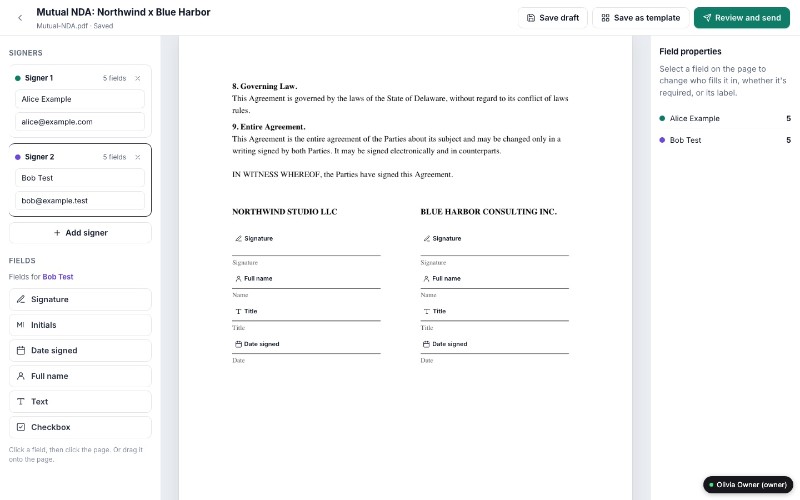
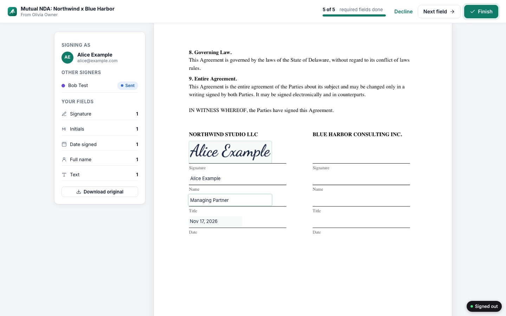
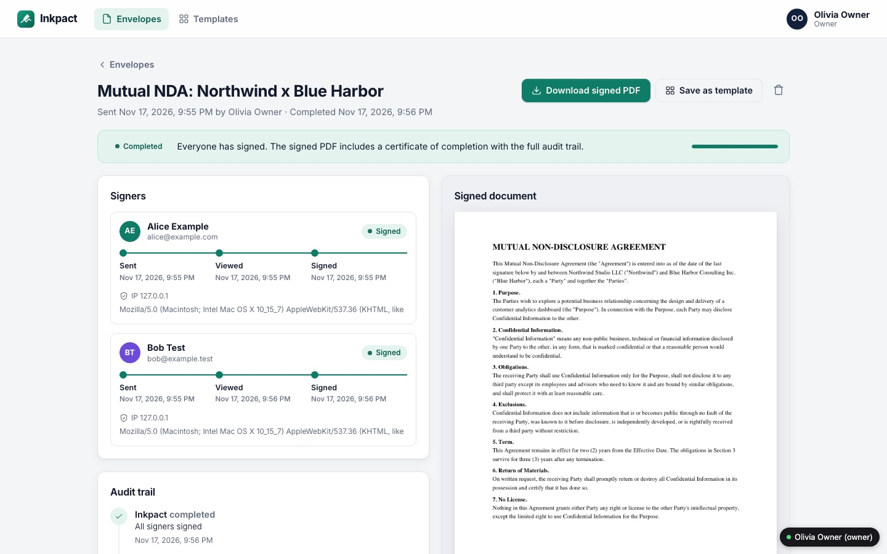
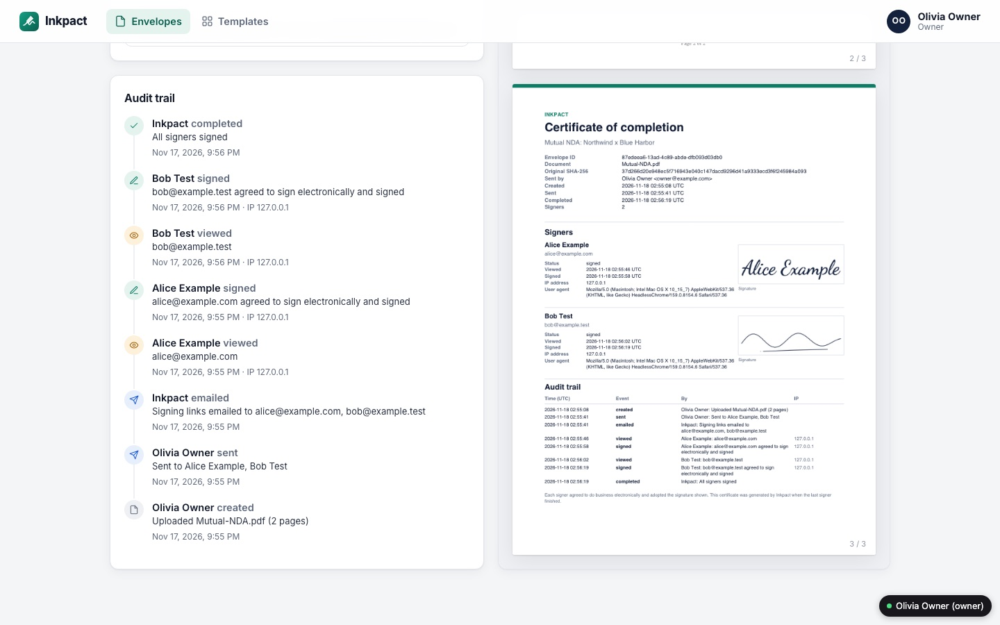

# Inkpact

Free, open-source e-signatures: a DocuSign alternative. Upload a PDF, place fields for each signer, send private signing links, and download the signed copy with a certificate of completion.



[Watch the 90-second demo](store/demo.mp4) · [Run it on AppKeep](https://appkeep.io/apps/inkpact)

## What it does

- **Any PDF, any number of signers.** Place signature, initials, date, name, text and checkbox fields for up to 20 signers.
- **Links you can see.** Each signer gets a private signing link by email, and you can always copy it yourself.
- **No account for signers.** Signers draw or type their signature in the browser.
- **Live status.** Each envelope moves from sent to viewed to signed to completed.
- **Audit trail built in.** The signed PDF ends with a certificate of completion: who signed, when, from which IP address and browser, and SHA-256 fingerprints of the original and signed files.
- **Templates.** Save any envelope as a template and reuse its fields.
- **AI tools.** `list_envelopes` and `get_envelope_status`, so an AI assistant can check what's waiting on whom.

| Signing | Completed | Certificate |
|---|---|---|
|  |  |  |

## How it's built

A single [Cloudflare Worker](https://developers.cloudflare.com/workers/) made for [AppKeep](https://appkeep.io), which handles sign-in, the database, file storage and email.

| Path | What's there |
|---|---|
| `src/index.ts` | The Worker ([Hono](https://hono.dev)): envelopes, signers, fields, events, templates, the public signing routes `/s/:token/*` and the AI tools |
| `src/stamp.ts` | Draws every signature and field onto the PDF and adds the certificate page ([pdf-lib](https://pdf-lib.js.org)) |
| `client/` | The browser app: PDF rendering ([pdf.js](https://mozilla.github.io/pdf.js/)), the field editor, the signature pad and the signing page |
| `migrations/` | The SQLite schema |
| `build.mjs` | Bundles the Worker and the client with esbuild |
| `altstack.json` | The AppKeep manifest: permissions, settings, store page |

## Run it locally

```bash
npm install
npm run build
npx appkeep@latest dev     # http://localhost:3000, signed in as the owner
```

No account is needed. Email is printed to the terminal instead of sent. To see a signing link as a signer would, open `/_altstack/logout?next=/s/<token>`.

## Publish your own version

Change what you like, bump `version` in `altstack.json`, then:

```bash
npx appkeep@latest login
npx appkeep@latest check
npx appkeep@latest publish
```

See the [AppKeep docs](https://appkeep.io/docs) for the manifest and the CLI.

## License

[MIT](LICENSE). The bundled fonts (Inter and Dancing Script) are under the SIL Open Font License.

Electronic signature laws differ by country. Inkpact records what a typical audit trail needs, but it isn't legal advice: check what your documents require.
